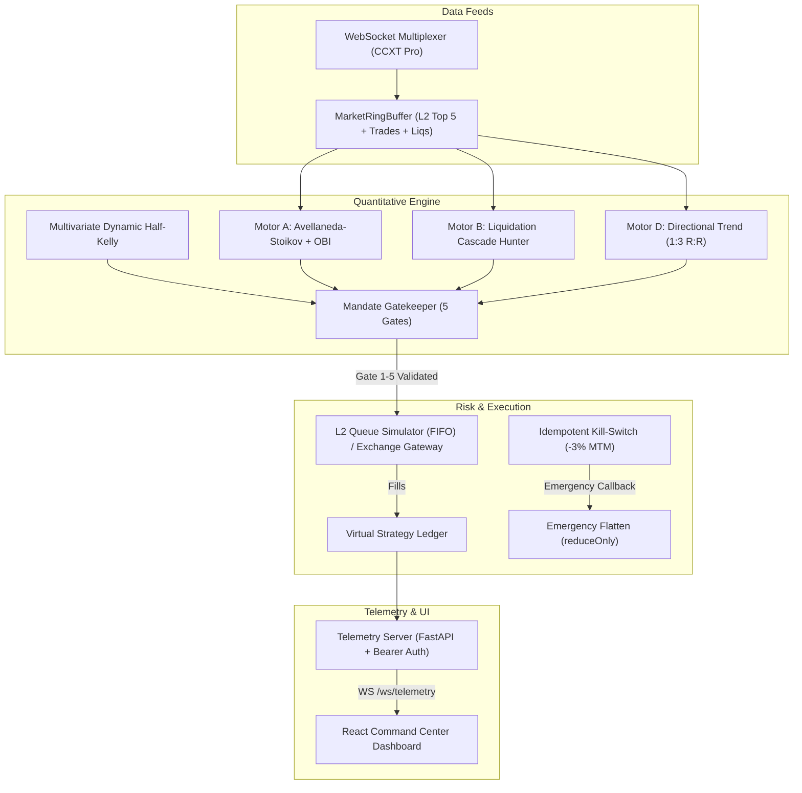

# Apex Quant HFT — Institutional Algorithmic Trading Platform

Plataforma cuantitativa institucional de trading algorítmico y de alta frecuencia (HFT) en derivados perpetuos y macroactivos (Cripto + TradFi). Desarrollada con un backend asíncrono en **FastAPI (Python 3.12)** acoplado a un motor de ejecución de baja latencia con colas L2 en microsegundos, y un **Centro de Comando en React 19 + TypeScript + Tailwind CSS**.

> [!WARNING]
> **ADVERTENCIA DE RIESGO FINANCIERO E INSTITUCIONAL**  
> El trading de derivados financieros, contratos perpetuos y apalancamiento conlleva un riesgo significativo de pérdida de capital. Este software implementa salvaguardas cuantitativas (Mandate Gates, Kill-Switch idempotente y corte de ruina), pero no garantiza ganancias ni elimina el riesgo de mercado. **NUNCA opere con capital real sin un período mínimo previo de validación de 2 a 4 semanas en modo PAPER_L2.**

---

## 1. Arquitectura del Sistema



### Componentes Clave
- **Motor Cuantitativo HFT**:
  - `AvellanedaStoikovOBIEngine`: Market making con microestructura L2, skew dinámico por desbalance del libro (OBI) y protección contra toxic order flow.
  - `DirectionalTrendStrategy`: Estrategia direccional de seguimiento de tendencia con ratio Riesgo/Beneficio 1:3, sizing por riesgo fijo (0.5% de equity por operación) y filtros de volatilidad ATR + régimen.
  - `LiquidationCascadeHunter`: Caza de rebotes tras cascadas de liquidaciones mayores a 3.2 desviaciones estándar.
- **Mandate Gatekeeper (5 Gates de Riesgo)**:
  - **Gate 1**: Validación estricta de límites de precio y ticks.
  - **Gate 2**: Obligatoriedad Post-Only Maker para estrategias no agresivas.
  - **Gate 3**: Tope de margen por par (máx 20% del capital base) y techo dinámico Half-Kelly.
  - **Gate 4**: Kill-Switch diario (-3% MTM o 10 pérdidas consecutivas) con cierre de emergencia (`reduceOnly`) y persistencia en disco WAL.
  - **Gate 5**: Límite estricto de concurrencia: máximo 5 posiciones simultáneas en cartera.
- **Motor de Simulación y Backtest Honesto**:
  - Física de ejecución con **cero lookahead**.
  - Fricciones de mercado reales: 2 bps maker, 5 bps taker, 2 bps de slippage en stops.
  - Precedencia conservadora: Stop-Loss tiene prioridad sobre Take-Profit en velas que tocan ambos límites.
  - Drawdown marcado a mercado (MTM) continuo en cada vela y manejo de ruina.

---

## 2. Requisitos Previos

- **Python**: 3.11 o 3.12 (recomendado 3.12)
- **Node.js**: v18.0 o superior
- **Git**

---

## 3. Instalación y Configuración

### 3.1. Clonar el Repositorio
```bash
git clone https://github.com/tu-usuario/trad-quant-hft.git
cd trad-quant-hft
```

### 3.2. Configuración del Backend (Python)
```bash
# Crear y activar entorno virtual
python -m venv .venv

# En Windows PowerShell:
.\.venv\Scripts\Activate.ps1

# En Linux/macOS:
# source .venv/bin/activate

# Instalar dependencias
pip install -r requirements.txt
```

### 3.3. Configuración del Frontend (React + Vite)
```bash
npm install
```

---

## 4. Variables de Entorno (.env)

Cree un archivo `.env` en la raíz del proyecto basándose en el siguiente esquema:

```env
# =============================================================================
# SEGURIDAD Y ACCESO A LA API
# =============================================================================
# Token Bearer obligatorio para todos los endpoints REST y WebSockets
API_AUTH_TOKEN=your-institutional-secret-bearer-token

# Lista blanca de orígenes CORS permitidos (separados por coma)
ALLOWED_ORIGINS=http://localhost:5173,http://127.0.0.1:5173,http://localhost:8000,http://127.0.0.1:8000

# =============================================================================
# MODO DE TRADING Y EJECUCIÓN
# Modos permitidos: PAPER_L2 | LIVE_BINANCE | LIVE_BINGX | LIVE_MULTI
# =============================================================================
TRADING_MODE=PAPER_L2

# Modo de estrategia: MARKET_MAKING | DIRECTIONAL_TREND
STRATEGY_MODE=DIRECTIONAL_TREND

# =============================================================================
# CREDENCIALES DE EXCHANGES (Requeridas solo para modos LIVE_*)
# =============================================================================
BINANCE_API_KEY=
BINANCE_API_SECRET=
BINGX_API_KEY=
BINGX_API_SECRET=

# =============================================================================
# WARM PATH: CONCILIO DE RÉGIMEN AI (Opcional)
# =============================================================================
GEMINI_API_KEY=
```

---

## 5. Ejecución del Sistema

### 5.1. Ejecutar la Suite de Pruebas Automatizadas
El repositorio cuenta con 128 tests automatizados con verificación matemática rigurosa:
```bash
pytest -v
```

### 5.2. Ejecutar el Servidor de Telemetría (Backend)
```bash
uvicorn backend.telemetry_server:app --host 0.0.0.0 --port 8000 --reload
```
- API REST: `http://localhost:8000`
- Documentación Swagger/OpenAPI: `http://localhost:8000/docs`
- WebSocket de telemetría: `ws://localhost:8000/ws/telemetry?token=<TU_API_AUTH_TOKEN>`

### 5.3. Ejecutar el Centro de Comando (Frontend)
En una terminal separada:
```bash
npm run dev
```
Acceda al panel de control en `http://localhost:5173`.

### 5.4. Ejecutar el Torneo Cuantitativo (Market Making vs. Direccional 1:3)
Para evaluar comparativamente ambas estrategias bajo condiciones fuera de muestra con más de 500 operaciones:
```bash
python -m backend.strategies.tournament
```
Los resultados se almacenan en `backend/config/tournament_results.json`.

---

## 6. Endpoints Críticos y Protocolo de Confirmación

Para prevenir operaciones accidentales (errores "fat-finger"), los endpoints sensibles y destructivos exigen el parámetro `confirm` en el cuerpo JSON y token Bearer:

| Método | Endpoint | Payload Obligatorio | Descripción |
|---|---|---|---|
| `POST` | `/api/trading-mode` | `{"mode": "LIVE_BINANCE", "confirm": "LIVE"}` | Conmuta a ejecución real en exchange |
| `POST` | `/api/reset-kill-switch` | `{"confirm": "RESET_KILL_SWITCH"}` | Restablece el interruptor de emergencia |
| `POST` | `/api/reset-state` | `{"confirm": "RESET_STATE"}` | Reinicia balances y estado de cartera |
| `POST` | `/api/base-capital` | `{"base_capital_usd": 10000, "confirm": "UPDATE_CAPITAL"}` | Actualiza el capital asignado |
| `POST` | `/api/strategy-mode` | `{"strategy_mode": "DIRECTIONAL_TREND"}` | Conmuta entre Market Making y Direccional |
| `POST` | `/api/stress-event` | `{"event_type": "FLASH_CRASH_5PCT", "confirm": "INJECT_CHAOS"}` | Inyección de caos (solo en `PAPER_L2`) |

---

## 7. Filosofía de Transparencia Cuantitativa

1. **Cero Métricas Falsas**: Los fills de entrada registran PnL realizado de \$0.00. La tasa de aciertos (*win rate*) se calcula estrictamente sobre operaciones cerradas con retorno neto positivo (`pnl_usd > 0`).
2. **Deflated Sharpe Ratio (DSR) Honesto**: Cuando la muestra estadística es menor al umbral requerido, el sistema reporta `"INSUFICIENTE (n trades)"` sin asumir Sharpe inflados artificialmente.
3. **Half-Kelly Dinámico**: La fracción de Kelly se calcula a partir de la varianza real móvil de los retornos observados, protegiendo el capital ante regímenes de alta volatilidad.
